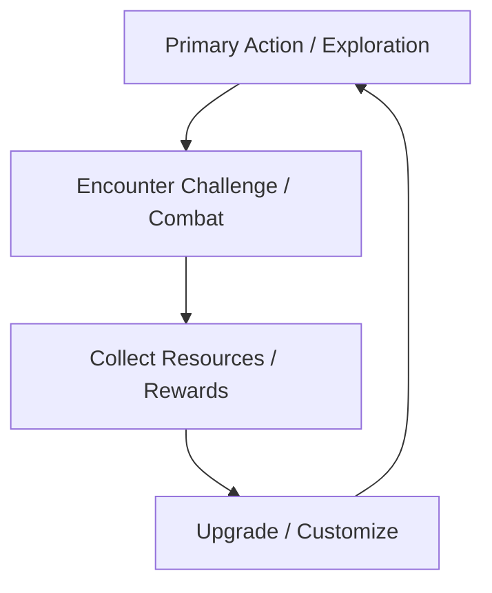

# Core Loop
> [!info] Guideline
> Map the primary cyclical sequence of gameplay actions, rewards, and progression steps. What does the player do repeatedly every 2 to 5 minutes?
> > [!tip] You can create your flowcharts using [mermaid](https://mermaid.js.org/) or [draw.io](https://draw.io) as they are compatible within Obsidian. (draw.io requires a community plugin)

> [!hint] You can link each action to its own page.

- **[[Exploration]]:** Write a short description of how this mechanic is experienced by the player.
- **[[Combat]]:** Write a short description of how this mechanic is experienced by the player.
- **[[Rewards]]:** Write a short description of how this mechanic is experienced by the player.
- **[[Upgrade]]:** Write a short description of how this mechanic is experienced by the player.

# Controls & [[Player Actions]]
> [!info] Guideline
> Map system inputs to specific in-game actions, output behavior, and operational constraints.
> > [!tip] Attach an image of the controller you wish to use with the actions mapped out.

- **Camera View:** (e.g., Top-down isometric, 3rd-person over-the-shoulder, 2D side-scroller)
- **Movement Profile:** (e.g., High-velocity, momentum-based, grid-based, turn-based)

| Input                    | Action             | Context / Notes                               |
| ------------------------ | ------------------ | --------------------------------------------- |
| `W/A/S/D` / `Left Stick` | [[Movement]]       | Analog movement sensitivity applied           |
| `Space`/ `Button South`  | [[Jump]]           | Hold to extend jump height                    |
| `LShift` / `Button East` | [[Dash]]           | Grants 0.2s invulnerability frames (i-frames) |
| `J` / `Button West`      | [[Primary Attack]] | 3-hit combo chain                             |
## Game Rules & Logic
> [!info] Guideline
> Define the operational boundary rules, victory/defeat criteria, and state-persistence systems governing the game session.
- **Win Condition**: Explicit criteria required to complete a level, run, or entire game session (e.g., Defeat the final boss, reach the extraction point, survive for 10 minutes.)
- **Fail Condition:** Explicit criteria that trigger a loss state or session reset (e.g., Player health drops to 0, mission timer reaches zero, target asset is destroyed.)
- **Failure Penalty:** Systemic consequences of failure (e.g., Loss of unbanked resources, respawn at last checkpoint, complete run restart.)
- **Save & Persistence System:** Architecture for saving progress (e.g., Automatic saving at designated checkpoints, manual save files, persistent character unlocks across sessions.)
